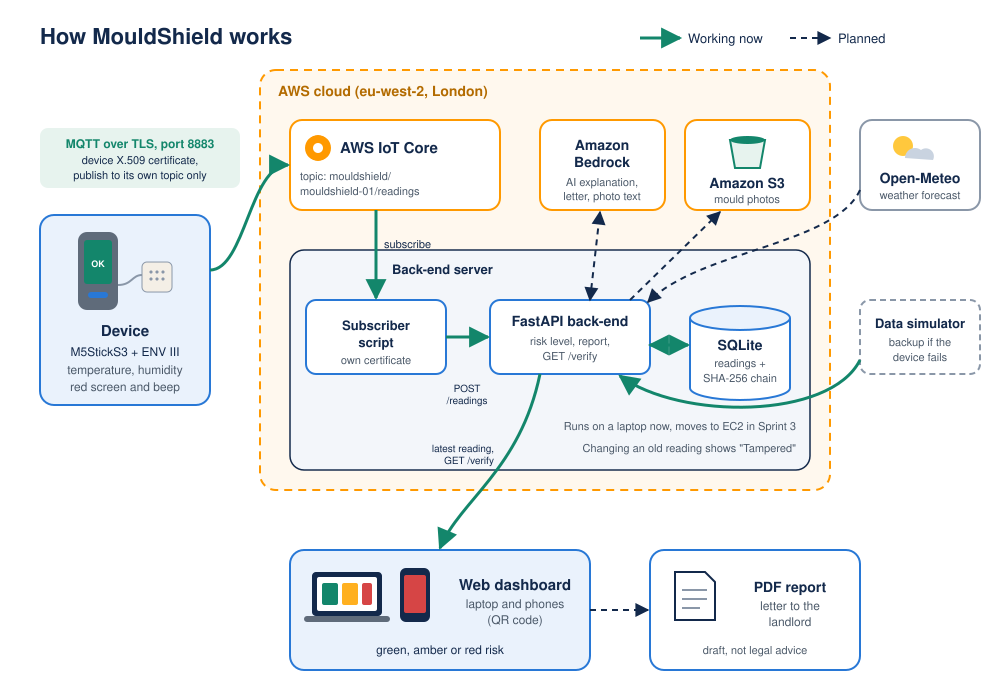

<p align="center">
  
</p>

# MouldShield

Early warning for damp and mould in rented homes, with tamper-evident readings.

CPU4106 Group Project, Fly-Tech internship scenario. Team **THE SHARKS**.

**Live dashboard:** https://d15ad8kcnyn7ke.cloudfront.net

## What it does

- A small device (M5StickS3 with an ENV III sensor) measures temperature and humidity in a room.
- The readings are sent to the cloud and a web dashboard shows the risk as green, amber or red.
- AI explains the risk in plain words and writes a draft letter to the landlord.
- Every reading is linked to the one before it with a SHA-256 hash. If someone changes old data, the chain breaks and the dashboard shows "Tampered".

## SDGs

- SDG 3: Good health and well-being
- SDG 10: Reduced inequalities
- SDG 11: Sustainable cities and communities

## How it works

<p align="center">
  
</p>

All arrows work on the live system (28 October 2026). The device sends real readings to AWS IoT Core and the subscriber on our EC2 server saves them in SQLite through FastAPI. The back-end uses Amazon Bedrock for the explanation, the landlord letter and the photo descriptions, keeps photos in a private S3 bucket and gets the weather from Open-Meteo for the condensation forecast. The dashboard and the PDF report are served over HTTPS through CloudFront (see `deploy/README.md`). The server has no AWS keys: it uses an IAM role. The data simulator is only a backup if the device fails, so its arrow is dashed.

## Repository structure

| Folder | What goes in it |
|--------|-----------------|
| `backend/` | FastAPI app, database, risk calculation, hash chain, AI and forecast logic, data simulator |
| `device/` | MicroPython code for the M5StickS3 (UiFlow2 firmware) |
| `dashboard/` | Web dashboard, mobile page and the system diagrams (Use Case, DFD) |
| `docs/` | Product backlog, stand-up records, sprint reviews, test plan and results |
| `deploy/` | Files to run the back-end on the AWS EC2 server (T16) |

## Where to put your files

Not sure where something goes? Use this table. Every file name starts with the task number when it belongs to one task, so it is easy to find later.

| What you made | Folder | Example name |
|---------------|--------|--------------|
| Code for the device (MicroPython) | `device/` | `device/sensor_screen.py` |
| Back-end code (FastAPI, database, scripts) | `backend/` | `backend/hash_chain.py` |
| Dashboard and mobile page (HTML, CSS, JavaScript) | `dashboard/` | `dashboard/index.html` |
| Use Case diagrams and DFDs (T15) | `dashboard/diagrams/` | `dashboard/diagrams/T15_use_case.png` |
| Wireframes, persona and other design files | `docs/design/` | `docs/design/T05_persona.png` |
| Research notes with sources | `docs/research/` | `docs/research/T04_humidity_thresholds.md` |
| Test plan and test results (T22) | `docs/testing/` | `docs/testing/T22_test_results.md` |
| Stand-up notes, sprint reviews | `docs/standups/` | `docs/standups/2026-10-22.md` |
| Backlog and risk register | `docs/agile/` | Kept by the Scrum Master |
| Logo and images used by the README | `assets/` | `assets/logo.svg` |

Some things never go in the repository: certificates and keys (`*.pem`, `*.key`, `*.crt`), the `.env` file, the database file (`mouldshield.db`) and the `.venv` folder. `.gitignore` already blocks them, but check before you upload.

To add a file without Git: open the right folder on GitHub, click **Add file**, then **Upload files**, and start the commit message with the task number, for example `#15 add the use case diagram`. That links the commit to the card on the board.

## Tech stack

- Device: MicroPython on UiFlow2 firmware
- Back-end: Python, FastAPI, SQLite
- Cloud: AWS IoT Core, Amazon EC2, Amazon CloudFront, Amazon Bedrock, Amazon S3
- Weather: Open-Meteo
- Project management: GitHub Projects (Scrum board)

## Running the back-end locally


```
cd backend
python -m venv .venv
.venv\Scripts\activate
pip install -r requirements.txt
uvicorn main:app --reload
```

On macOS or Linux, activate the environment with `source .venv/bin/activate` instead.

Then open http://127.0.0.1:8000/docs to test the endpoints. More details, including the simulator and the MQTT subscriber, are in `backend/README.md`.

To see the dashboard, start the back-end first, then run `python run.py` in the `dashboard` folder (or double-click `START_WINDOWS.bat`) and open http://127.0.0.1:8080. Click **Connect to API** to switch from demo data to the real readings. More details are in `dashboard/README.md`.

Copy `.env.example` to `.env` in the project root and fill in your own values. The `.env` file is never committed.

## Tests

```
cd backend
python -m unittest discover tests
```

```
cd dashboard
node --test tests/*.test.js
python -m unittest discover tests
```

On 28 October 2026: 56 back-end tests, 23 dashboard JavaScript tests and 8 dashboard Python tests, all passing. The back-end tests use fake AWS and weather services, so they never call Bedrock, S3 or Open-Meteo.

## Endpoints

| Method | Path | Purpose | Status |
|--------|------|---------|--------|
| POST | `/readings` | Save a new reading and link it to the hash chain | Working (T07, T12) |
| GET | `/readings/latest` | Return the most recent reading with its risk level | Working (T07, T10) |
| GET | `/readings/history` | Return the readings of the last 7 days for the graphs | Working (T17) |
| GET | `/verify` | Check the hash chain and report "OK" or "Tampered" | Working (T12) |
| POST | `/report` | Create the AI explanation and the landlord letter | Working (T10, T13) |
| GET | `/forecast` | Condensation warning for the next 48 hours, from the Open-Meteo forecast | Working (T17) |
| POST | `/photos` | Add a photo of the damp; AI describes it (server only) | Working (T18) |
| GET | `/photos` | List the photos with their AI description (server only) | Working (T18) |
| GET | `/photos/{id}/image` | Return a photo, after checking it was not changed (server only) | Working (T18) |

On the EC2 server the same endpoints are under `/api` (for example `/api/verify`). From outside, only GET requests are allowed, plus `POST /api/photos` and `POST /api/report`, which both have daily limits.

There is no PUT, PATCH or DELETE for readings, on purpose: readings are evidence, so they are only ever added.

## Team

| Name | Role |
|------|------|
| Adrian Lupescu | Scrum Master, developer (cloud and security) |
| Sergiu Girnita | Developer (back-end and AI) |
| Claudiu Stratulat | UI/UX Designer, developer (front-end and testing) |

## How we work

- Tasks live on the GitHub Projects board: To do, In progress, Done. Each feature task has a MoSCoW label (Must or Should) and a Sprint value.
- The product backlog (user stories, MoSCoW, sprint goals and Definition of Done) is in `docs/agile/product_backlog.md`, and the risk register in `docs/agile/risk_register.md`.
- We commit straight to `main`. The project is small and we work on different folders, so we do not use branches or pull requests.
- Commit messages are short and start with the task number, for example `#7 add POST /readings`. This links the commit to the card on the board.
- When a task is ready, the owner leaves a comment on its issue. One teammate checks the work and answers in the same issue, and then the card moves to Done.
- A task is Done when the code is on GitHub, tested, and checked by one teammate.
- Stand-up notes (attendance and decisions), sprint reviews and retrospectives are kept in `docs/standups/`.

## Security

- Keys, passwords and device certificates are never committed. They stay in `.env` or in ignored files (see `.gitignore`).
- Each team member has their own IAM user on AWS. The root account has MFA and is not used for daily work.
- A budget alert is set on the AWS account.
- The dashboard is only reachable over HTTPS, through CloudFront. The EC2 server accepts HTTP only from CloudFront, and SSH only from the Scrum Master.
- From outside, data can only be read. Only the subscriber on the server can save readings, so nobody can add fake readings to the hash chain. The two exceptions are adding a photo (T18), with a limit of 20 photos in any 24 hours, and asking for the report (T13), with a limit of 50 AI calls in any 24 hours (after that it uses a fixed text). Neither of them saves a reading.
- Photos are saved in a private S3 bucket as a clean JPEG, without their hidden data. The location from the photo is kept only in the database on the server and is never sent back by the API (a test checks this).
- The EC2 server has no AWS keys. It uses an IAM role that can only put and read photos in our bucket and call Amazon Bedrock.
- The full security check of the live system (T21) is in `docs/security/T21_security_check.md`.

## Limitations

- The readings are tamper-evident, not tamper-proof: someone with full access to the database could recalculate every hash. Keeping a copy of the hashes outside the server is future work.
- Letters created by MouldShield are drafts, not legal advice.
- The condensation forecast assumes the room stays at the last reading, and it uses the weather for London only.
- AI describes photos of damp and mould. It does not diagnose anything.
- The date and phone model in a photo come from its EXIF data, which anyone can edit. The stronger evidence is the SHA-256 of the uploaded file and the upload time from our server.
- When a photo is chosen in a browser on an iPhone, iOS often removes the EXIF data (always the location, by default). We saw this in our own test on 27 October, so for iPhone uploads the date and phone are usually missing.
- If AI sees no damp in a photo, the tenant is asked if they still want to add it. AI can be wrong, so the tenant always decides.

## Credits

Weather data by [Open-Meteo.com](https://open-meteo.com/) (CC BY 4.0).
