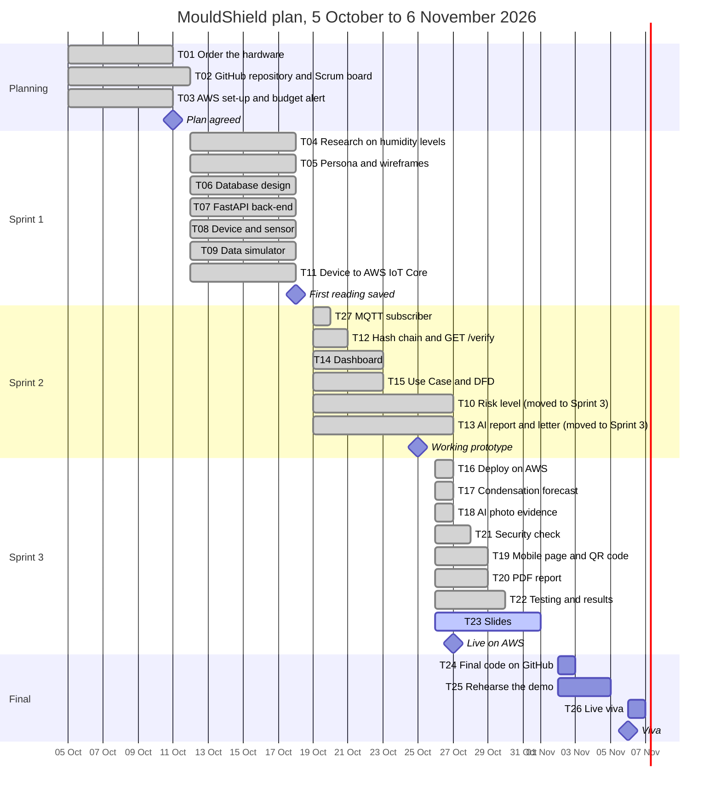

# Gantt chart and milestones

MouldShield, team THE SHARKS. Kept by the Scrum Master (Adrian). Last updated: 30 October 2026.

The chart shows the five weeks of the project: one planning week, three one-week sprints and a final week for the viva. Each bar is a task (issue number = task number) and ends on the day it was Done on the Scrum board. The sprint plan and the reasons for each change are in `product_backlog.md`.

## Milestones

| Milestone | Planned | Reached | Evidence |
|-----------|---------|---------|----------|
| Plan agreed | 11 Oct (end of Week 1) | 11 Oct | Proposal, backlog and Scrum board |
| First reading saved in the database | 18 Oct (end of Sprint 1) | 18 Oct | `POST /readings` with SQLite, agreed at the Sprint 1 review (`../standups/2026-10-19_sprint-1-review.md`) |
| Working prototype | 25 Oct (end of Sprint 2) | 25 Oct, without T10 and T13 | Device, subscriber, hash chain and dashboard working together; T10 and T13 moved to Sprint 3 |
| Live on AWS | Sprint 3 | 27 Oct | T16: back-end and dashboard on EC2 with HTTPS through CloudFront |
| Final code on GitHub | 2 Nov | | T24 |
| Viva | 6 Nov (Week 5, Session 2) | | T26 |

## Changes to the plan

- T10 (risk level) and T13 (AI report and letter) were planned for Sprint 2. They moved into Sprint 3 and were Done on 27 October.
- T16 (deploy on AWS) was moved from Sprint 2 to Sprint 3 on 13 October, so the server only runs (and costs credit) when the back-end is ready.
- T27 (MQTT subscriber) was added to Sprint 2 on 19 October.
