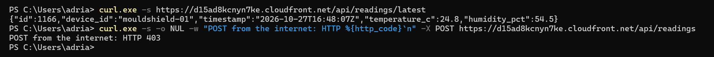
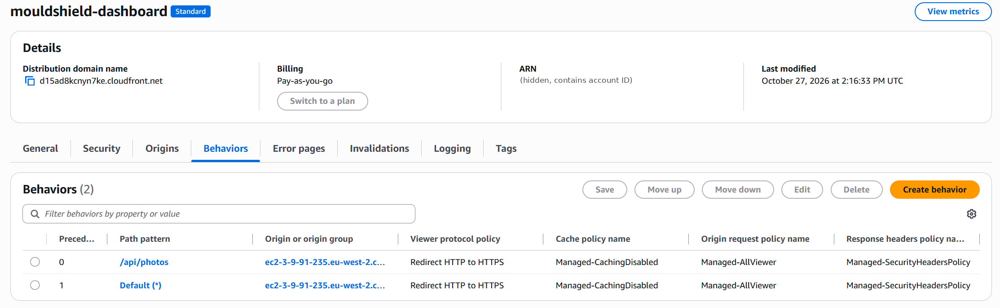
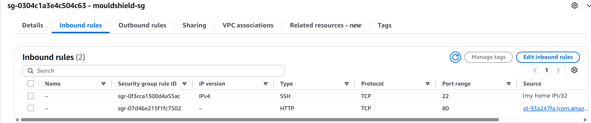
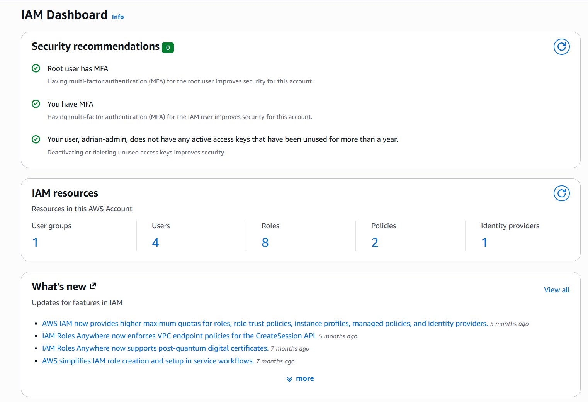
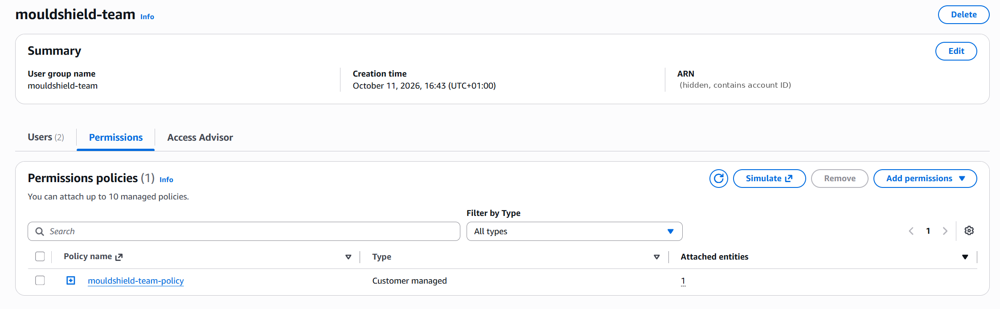
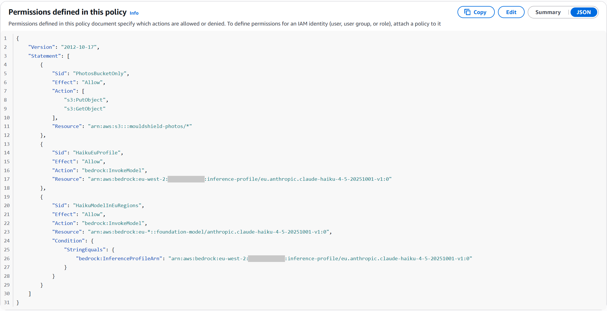
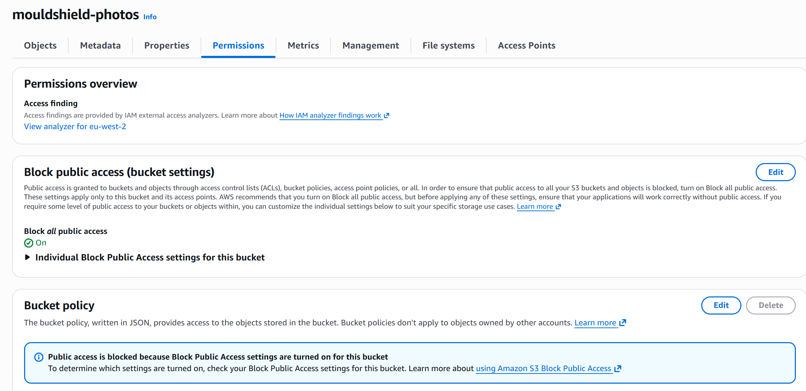
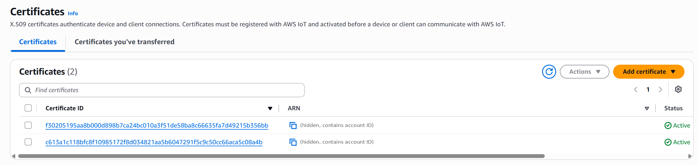

# T21 Security check before the final version

Adrian, 28 October 2026. I did this on the live site (https://d15ad8kcnyn7ke.cloudfront.net) once T10, T13, T16, T17 and T18 were all running on the server.

I started from the outside, with what a random person on the internet can see and send, and then moved inwards to the server, the AWS permissions, the device and the data. For each part I wrote down what I checked and what happened. The screenshots are in `images/` and I covered our AWS account ID and my home IP in all of them.

## 1. What anyone on the internet can see

Checked in Chrome on the live site.

| Check | Result |
|-------|--------|
| Opening the site with `http://` | Goes to `https://` by itself (CloudFront redirect) |
| Security headers on the page and the API | All there, added by CloudFront: HSTS for one year (the browser only uses HTTPS for our site), `nosniff`, `SAMEORIGIN` (our page cannot be hidden inside another site) and a referrer policy |
| Changing data from outside | PUT, DELETE and POST on `/api/readings`, DELETE on `/api/photos` and PATCH on `/api/report` all get 403 |
| Sensitive files | `/.env`, `/.git/config`, `/mouldshield.db`, `/backend/main.py` and a `../` path all get 404 |
| Caching | Every request says `Miss from cloudfront`, so CloudFront does not keep old readings |

## 2. What someone can send

Checked in Chrome on the live site. None of these reached Bedrock, so they cost nothing.

| What I sent | Result |
|-------------|--------|
| Text pretending to be a JPEG | 415 "Please upload a photo" |
| Empty upload | 400 "No photo received" |
| An HTML file with a script tag | 415 |
| A 16 MB file | 413 "The photo is too big (15 MB at most)" |
| Report with language `xx` | 422 |
| Report for a reading that does not exist | 404 |
| Report with text instead of JSON | 422 |
| Report with fake numbers (99.9 % humidity, another device and date) | 200, but the letter uses the real values from the database. 99.9 never appears |

For me the last one is the most important. You cannot get a letter with made-up numbers, because the server only uses the reading id and takes everything else from the database.

I did not try the daily limits live (20 photos and 50 reports in 24 hours) because that would use real credit. The unit tests cover them and they all pass.

I also looked at the code: the text from the AI (photo descriptions and the report explanation) goes on the page as plain text, not HTML, so a strange AI answer cannot add a script to the page.

## 3. The EC2 server

Checked over SSH and in the EC2 console.

| Check | Result |
|-------|--------|
| Security group | SSH (22) only from my IP, HTTP (80) only from the CloudFront prefix list |
| Ports listening on the server | Only 80 (the site) and 22 (SSH). DNS (53) only on localhost |
| SSH | Password login off, key only |
| Services | API and subscriber both run as `ubuntu`, not root |
| Subscriber certificates | Folder and files can only be read by `ubuntu` (700 and 600) |
| AWS keys on the server | None. The server uses the IAM role |
| IMDSv2 | Required (this stops a trick where someone gets the server to hand over its AWS role details) |
| Automatic security updates | On |

## 4. AWS permissions

Checked in the IAM and S3 consoles.

| Check | Result |
|-------|--------|
| IAM security recommendations | 0. The root user has MFA, my admin user has MFA, no old unused access keys |
| Team group `mouldshield-team` | IoT is read only, so the team cannot change or delete the device, certificates or IoT policies. In IAM each person can only manage their own password, MFA and keys. S3 only on buckets that start with `mouldshield-` |
| Server role `mouldshield-ec2-role` | Only put and get in `mouldshield-photos` and only Claude Haiku 4.5 through the EU profile. It cannot delete anything |
| S3 bucket `mouldshield-photos` | Block all public access is On and there is no bucket policy, so the photos are private |

## 5. The device and AWS IoT

| Check | Result |
|-------|--------|
| Keys and certificates on GitHub | None, also not in the whole git history. `.gitignore` blocks `*.pem`, `*.key`, `*.crt`, `certs/` and `.env` |
| Connection | MQTT over TLS on port 8883, so the data is encrypted. The device also checks it is really talking to AWS |
| IoT policies | Each identity can only use its own client ID and topic (tested in Sprint 1 and Sprint 2, access denied on any other topic) |
| IoT certificates | Exactly 2, both active: the device and the subscriber. The certificate from my Week 3 mistake is gone |

## 6. Data

| Check | Result |
|-------|--------|
| Hash chain | `GET /verify` OK, 3116 readings checked on 28 Oct |
| Photo location | The API never sends GPS back (checked live on 4 photos, and a unit test fails if it ever does) |
| Hidden data in photos | The saved JPEG has no EXIF data (checked live) |
| Open-Meteo | We only send the coordinates of London, nothing about the tenant, and the API does not send them back |

## 7. Fixed during this check

- **Photo uploads without a size header.** Found by Sergiu in his review of T18: the 15 MB check only worked when the browser said how big the file was. Now the server reads the upload in pieces and stops at 15 MB. A test sends 100 MB in chunks: the old code read all of it, the new code stops at about 16 MB (`1832959`).
- **Database file permissions.** `mouldshield.db` could be read by any user on the server (`644`). Changed to `600`, so only `ubuntu` can read it.
- **Kernel updates.** Six packages were waiting, all for the Linux kernel. Installed them and rebooted. Both services came back by themselves 17 seconds after the reboot.

## 8. Still open (future work)

| # | Point | Risk | Why we leave it for now |
|---|-------|------|------------------------|
| 1 | No WAF in front of CloudFront (R10) | Low | About $14 a month. The upload limits and the read only rule cover the main abuse for a demo |
| 2 | Plain HTTP between CloudFront and the server (R11) | Low | Users only get HTTPS and port 80 only accepts CloudFront. A real version would use HTTPS to the server or a CloudFront VPC origin |
| 3 | No Content-Security-Policy header | Low | A wrong policy could break the dashboard just before the code freeze. Worth adding and testing in a real version |
| 4 | The `server: uvicorn` header shows what we use | Very low | The code is public on GitHub anyway |
| 5 | Swagger (`/api/docs`) is public | Low | Kept on purpose for the demo. The routes are in the README anyway |
| 6 | Dashboard developer files (`run.py`, `README.md`) can be downloaded from the site | Low | No secrets in them and the repo is public |
| 7 | Error message for a body that is not JSON shows details | Very low | Standard FastAPI answer, no data in it |
| 8 | Device TLS clock workaround (R6) | Medium | We stay on firmware v2.5.3. After any firmware update the AWS connection must be tested again |

## Result

I did not find anything that puts the evidence of the tenant at risk. Nobody on the internet can add, change or delete readings, the letter only uses real data, the photos are private and no keys are on GitHub. The points in section 8 are things I would do for a real product, but they are fine for our demo.
